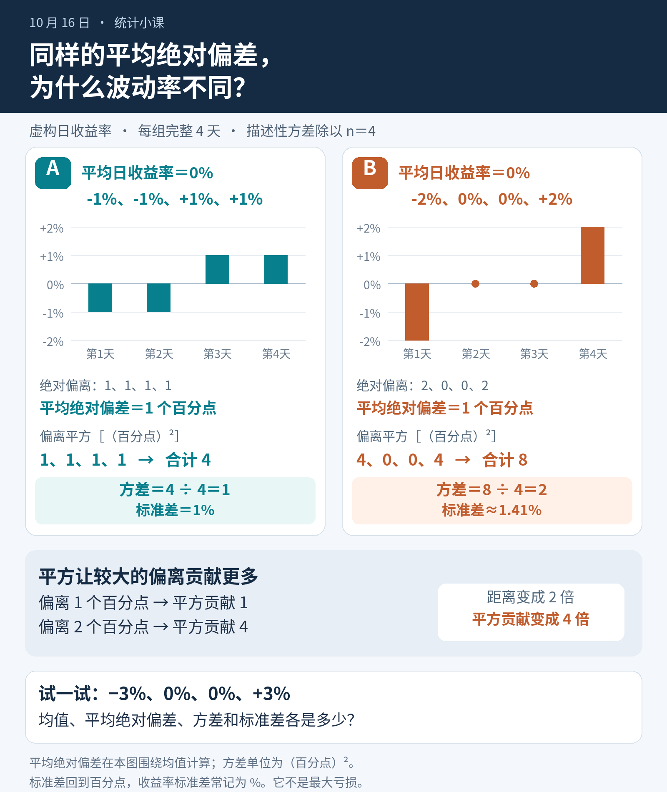
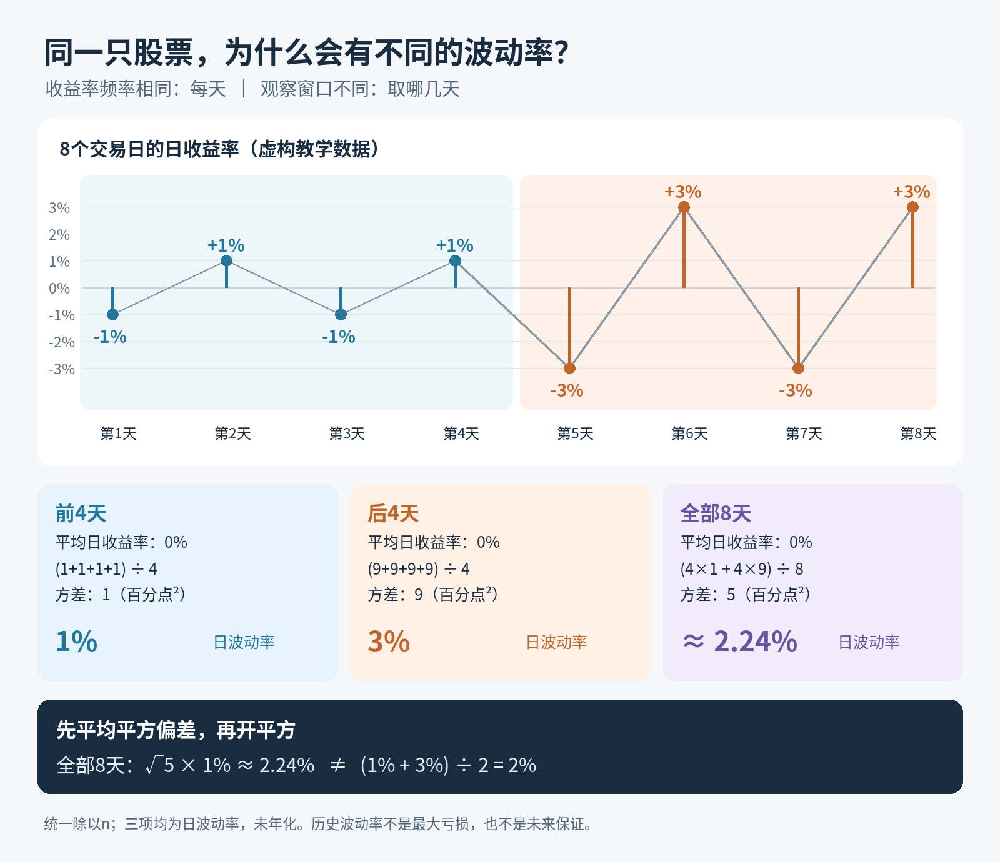

# 方差、标准差与波动率

<blockquote class="callout callout-abstract">
核心命题
波动率是收益分布离散程度的估计，不等于全部风险。其年化、预测和比较都依赖时间结构与数据口径。

</blockquote>
<h2 id="section-1">一、本课目标</h2>
<ul>
<li>理解总体方差、样本方差、标准差和波动率；</li>
<li>解释为什么样本方差常使用 $n-1$；</li>
<li>推导平方根时间年化的条件；</li>
<li>识别波动聚集、重叠收益和非同步数据带来的问题；</li>
<li>使用滚动与指数加权方法估计波动率。</li>
</ul>
<h2 id="section-2">二、方差与标准差</h2>

总体方差：

$$
Var(R)=E[(R-\mu)^2]
$$

样本方差：

$$
s^2=\frac{1}{n-1}\sum_{t=1}^{n}(R_t-\bar R)^2
$$

样本标准差：

$$
s=\sqrt{s^2}
$$

方差单位是“收益率平方”，标准差恢复到收益率单位，所以金融报告通常使用标准差作为波动率。
<figure class="inline-figure" data-figure="l03-deviations"><canvas role="img" aria-label="数据 2、4、6 的离差是 −2、0、+2，加总为 0；平方后是 4、0、4，不会抵消。"></canvas><figcaption>数据 2、4、6 的离差是 −2、0、+2，加总为 0；平方后是 4、0、4，不会抵消。 可调：<a href="#/lab/prep-variance">离差与标准差</a>。</figcaption></figure>

<strong>已讲短复习：</strong>完整四个等概率教学情形的日收益率为 −2%、−1%、+1%、+2%，均值为 0%；描述性方差为 (4 + 1 + 1 + 4) ÷ 4 = <strong>2.5 百分点²</strong>，标准差为 √2.5 ≈ <strong>1.58 个百分点（通常记作 1.58%）</strong>，平均绝对偏差为 (2 + 1 + 1 + 2) ÷ 4 = <strong>1.5 个百分点</strong>。这是完整等概率教学模型，统一除以 4，未年化；<strong>波动率不是最大亏损</strong>。

<h3 id="n-1">为什么除以 $n-1$</h3>

使用样本均值 $\bar R$ 后，残差满足：

$$
\sum_{t=1}^{n}(R_t-\bar R)=0
$$

因此只有 $n-1$ 个自由度。除以 $n-1$ 可使 IID 情形下样本方差成为总体方差的无偏估计。

在 Python 中：

<pre><code class="language-python">returns.var(ddof=1)
returns.std(ddof=1)
</code></pre>

<code>pandas.Series.std()</code> 默认通常使用 <code>ddof=1</code>，但生产代码仍建议显式写出。

<section class="cor-daily" aria-labelledby="squared-deviations-volatility">
  <h2 id="squared-deviations-volatility">为什么较大的偏离，会更明显地推高方差？</h2>
  
<time datetime="2026-10-16">2026-10-16</time> · 约 5–10 分钟

  
昨天我们看过：计算波动率时，选取的时间窗口会影响结果。今天把窗口固定下来，每组都只看下面完整列出的 4 天，专门比较“离均值有多远”怎样进入方差。这里计算的是这 4 天收益率的<strong>描述性方差，除以天数 n = 4</strong>；不使用除以 n − 1 的样本方差来做总体推断。

  <h3 id="squared-first-guess">先猜一猜：哪一组更波动？</h3>
  

    <table>
      <caption>两组虚构的日收益率，各含完整的 4 天</caption>
      <thead>
        <tr><th scope="col">组别</th><th scope="col">第 1 天</th><th scope="col">第 2 天</th><th scope="col">第 3 天</th><th scope="col">第 4 天</th><th scope="col">均值</th></tr>
      </thead>
      <tbody>
        <tr><th scope="row">A</th><td>−1%</td><td>−1%</td><td>+1%</td><td>+1%</td><td>0%</td></tr>
        <tr><th scope="row">B</th><td>−2%</td><td>0%</td><td>0%</td><td>+2%</td><td>0%</td></tr>
      </tbody>
    </table>
  

  
A 是 [−1, −1, +1, +1]%，B 是 [−2, 0, 0, +2]%。两组均值都为 0%，但 A 每天都有 1% 的涨跌，B 则有两天不动、两天涨跌 2%。先不计算：如果用标准差衡量日波动率，你猜 A 大、B 大，还是一样大？

  <h3 id="squared-absolute-distance">先用绝对距离：两组的平均值一样</h3>
  
先用每一天的收益率减去本组均值，得到<strong>偏差</strong>。收益率 1% 与均值 0% 之间的差，是 1 个百分点。由于两组均值都为 0%，A 的偏差是 [−1, −1, +1, +1] 个百分点，B 是 [−2, 0, 0, +2] 个百分点。

  
去掉正负号，再求算术平均，就得到这里的平均绝对偏差（MAD）：

  

    <table>
      <caption>以各组均值为中心，计算平均绝对偏差</caption>
      <thead>
        <tr><th scope="col">组别</th><th scope="col">4 天的绝对偏差（百分点）</th><th scope="col">绝对偏差之和（百分点）</th><th scope="col">MAD（百分点）</th></tr>
      </thead>
      <tbody>
        <tr><th scope="row">A</th><td>[1, 1, 1, 1]</td><td>1 + 1 + 1 + 1 = 4</td><td>4 ÷ 4 = 1</td></tr>
        <tr><th scope="row">B</th><td>[2, 0, 0, 2]</td><td>2 + 0 + 0 + 2 = 4</td><td>4 ÷ 4 = 1</td></tr>
      </tbody>
    </table>
  

  
所以两组的 MAD 都是 1 个百分点。这里的 MAD 明确指<strong>以均值为中心、对绝对偏差求算术平均</strong>，不是“中位数绝对偏差”。用距离的平均值看，两组一样；接下来换成平方，结论就会不同。

  <h3 id="squared-variance-contributions">偏差翻倍，平方后的贡献变成 4 倍</h3>
  
方差的做法是：把每个偏差平方，然后求平均。平方也会让正负偏差都产生非负贡献；较大的正偏差和负偏差，都会增加方差。

  
每个偏差 d = 当日收益率 − 本组均值；这 4 天的方差 = (d₁² + d₂² + d₃² + d₄²) ÷ 4。

  

    <table>
      <caption>方差是偏差平方的平均值，单位变成百分点²</caption>
      <thead>
        <tr><th scope="col">组别</th><th scope="col">4 天的偏差平方（百分点²）</th><th scope="col">平方和（百分点²）</th><th scope="col">方差（百分点²）</th></tr>
      </thead>
      <tbody>
        <tr><th scope="row">A</th><td>[1, 1, 1, 1]</td><td>1 + 1 + 1 + 1 = 4</td><td>4 ÷ 4 = 1</td></tr>
        <tr><th scope="row">B</th><td>[4, 0, 0, 4]</td><td>4 + 0 + 0 + 4 = 8</td><td>8 ÷ 4 = 2</td></tr>
      </tbody>
    </table>
  

  
<strong>2 个百分点的偏差，是 1 个百分点的 2 倍；平方后，贡献却是 4 ÷ 1 = 4 倍。</strong>B 的两个 0 偏差不贡献平方和，两个较远的点各贡献 4，合计 8；A 的四个点各贡献 1，合计 4。天数相同，B 的方差就是 A 的 2 倍，尽管它们的 MAD 相同。

  
这里说的“一个点的贡献”，始终相对于<strong>选定的均值</strong>。如果真的只修改一条收益率，均值也可能跟着改变，应先重算均值，再重算所有点的偏差。今天选择均值相同的两组，是为了清楚地看见平方的作用。

  <figure class="cor-figure">
    
    <figcaption>先看距离，再看平方：两组的平均绝对偏差相同，B 的方差更大。点击图片可放大。</figcaption>
  </figure>

  <h3 id="squared-back-to-volatility">开平方，才回到日波动率的单位</h3>
  
标准差是方差的平方根，也就是<strong>偏差的均方根</strong>：先平方、求平均，再开平方。它与先取绝对值再平均的 MAD，计算顺序和含义都不同。

  
A：标准差 = √1 = 1 个百分点，通常记作 1%。 B：标准差 = √2 ≈ 1.41 个百分点，通常记作 1.41%。

  
因此，B 的<strong>方差是 A 的 2 倍，标准差是 A 的 √2 倍</strong>，约为 1.41 倍。开平方时，单位也从“百分点²”回到“百分点”：偏差（百分点）→ 方差（百分点²）→ 标准差（百分点）。

  
如果改用小数形式表示收益率，例如把 1% 写成 0.01，那么 A、B 的方差分别为 0.0001 和 0.0002，标准差分别为 0.01 和约 0.0141，换回百分数仍是 1% 和约 1.41%。<strong>表示方式变了，描述的波动没有变。</strong>不要把百分点尺度的方差数值，直接搬到小数尺度上。

  <h3 id="squared-reading-the-result">1.41% 能说明什么？</h3>
  
这里的日波动率 1.41%，描述的是 B 这 4 天日收益率围绕均值的分散程度。它不是“每天平均绝对涨跌 1.41%”（B 的 MAD 是 1 个百分点），也不是最大亏损，更不是未来每天涨跌幅的保证。

  
较极端的真实收益同样是信息。不能因为它推高了波动率，就把它删掉；如果怀疑是录入错误，应先核对原始记录。平方对较大偏差更敏感，提醒我们认真理解这些观测，而不是回避它们。

  <h3 id="squared-try-it">练一遍：把 B 的幅度再放大 1.5 倍</h3>
  
仍然只描述完整的 4 天，C 的日收益率为 <strong>[−3, 0, 0, +3]%</strong>，方差仍除以 4。先自己算一遍，再展开答案：

  <ol>
    <li>C 的均值、MAD、方差和标准差各是多少？分别用什么单位？</li>
    <li>与 B 相比，C 的各项偏差幅度是 1.5 倍。MAD、方差、标准差各变为几倍？</li>
  </ol>
  

    
展开答案：从偏差逐步算到标准差

    
C 的均值为 (−3 + 0 + 0 + 3) ÷ 4 = <strong>0%</strong>，偏差为 [−3, 0, 0, +3] 个百分点。

    

      <table>
        <caption>C 的计算结果</caption>
        <thead><tr><th scope="col">指标</th><th scope="col">计算</th><th scope="col">结果</th></tr></thead>
        <tbody>
          <tr><th scope="row">MAD</th><td>(3 + 0 + 0 + 3) ÷ 4</td><td>1.5 个百分点</td></tr>
          <tr><th scope="row">方差</th><td>(9 + 0 + 0 + 9) ÷ 4</td><td>4.5 平方百分点（百分点²）</td></tr>
          <tr><th scope="row">标准差</th><td>√4.5 ≈ 2.12</td><td>约 2.12 个百分点，通常记作 2.12%</td></tr>
        </tbody>
      </table>
    

    
与 B 相比，C 的偏差幅度和 MAD 都是 <strong>1.5 倍</strong>；方差是 4.5 ÷ 2 = <strong>2.25 = 1.5² 倍</strong>；标准差是 √4.5 ÷ √2 = <strong>1.5 倍</strong>。倍率用未四舍五入的值计算。

    
推广到所有偏差都乘以 k：平方和与方差乘以 <strong>k²</strong>，标准差乘以 <strong>|k|</strong>。绝对值保证标准差不会因为 k 为负而变成负数。

  

  
<strong>记住这一点：</strong>MAD 看距离的平均值；标准差先把偏差平方，因此对较大的偏离更敏感。判断波动时，要同时说明数据窗口、计算方法和单位。本节数据为教学虚构示例，不构成投资承诺。

</section>

<h2 id="section-4">三、波动率年化</h2>

若日收益独立同分布，且方差为 $\sigma_d^2$，$N$ 日收益之和的方差为：

$$
Var\left(\sum_{t=1}^{N}R_t\right)=N\sigma_d^2
$$

因此标准差：

$$
\sigma_N=\sqrt{N}\sigma_d
$$

日波动年化常写为：

$$
\sigma_{annual}=\sigma_d\sqrt{252}
$$
<figure class="inline-figure" data-figure="l03-sqrt-t"><canvas role="img" aria-label="独立同分布时，波动按 √T 放大：日波动 1%，一年大约 16%，不是把 1% 乘 252。"></canvas><figcaption>独立同分布时，波动按 √T 放大：日波动 1%，一年大约 16%，不是把 1% 乘 252。</figcaption></figure>
<h3 id="section-5">存在自相关时</h3>

一般形式为：

$$
Var\left(\sum_{t=1}^{N}R_t\right)
=N\gamma_0+2\sum_{k=1}^{N-1}(N-k)\gamma_k
$$

其中 $\gamma_k=Cov(R_t,R_{t-k})$。只有所有非零滞后协方差近似为零时，平方根时间规则才直接成立。

<h2 id="section-6">四、波动率不是下行风险的同义词</h2>

标准差对正向和负向偏离同等惩罚。两个策略可能具有相同标准差，但一个呈对称波动，另一个多数小赚、偶尔巨亏。

所以实际风险报告还应结合：

<ul>
<li>下行偏差；</li>
<li>最大回撤；</li>
<li>偏度和峰度；</li>
<li>VaR/Expected Shortfall；</li>
<li>流动性和成交风险；</li>
<li>杠杆、集中度与尾部敞口。</li>
</ul>
<h2 id="section-7">五、波动聚集</h2>

金融收益常见现象是：原始收益线性自相关不强，但绝对收益或平方收益存在持续性：

$$
Corr(R_t^2,R_{t-k}^2)&gt;0
$$

这表示高波动往往成群出现，低波动也会持续。因此长期样本标准差只是平均水平，不一定适合作为下一期条件波动预测。

<h2 id="section-8">六、滚动波动率</h2>

长度为 $L$ 的滚动波动率：

$$
\hat\sigma_{t,L}=Std(R_{t-L+1},\ldots,R_t)
$$

<pre><code class="language-python">rolling_vol = returns.rolling(20).std(ddof=1) * np.sqrt(252)
</code></pre>

缺点：

<ul>
<li>窗口内观测权重相同；</li>
<li>当一个极端值离开窗口时会突然跳变；</li>
<li>窗口选择产生较大研究者自由度。</li>
</ul>
<section class="cor-daily" aria-labelledby="volatility-observation-windows">
  <h2 id="volatility-observation-windows">为什么同一只股票，会有不同的波动率？</h2>
  
<time datetime="2026-10-15">2026-10-15</time> · 约 7 分钟

  
你看到同一只股票的三份说明，日波动率分别写着 <strong>1%、3%、2.24%</strong>。先别急着判断谁算错了：如果它们取的历史天数不同，这三个数字可以同时成立。

  
今天只学一件事：<strong>“每隔多久记录一次收益”和“取多少天来计算”是两件事。</strong>前者叫收益频率，后者叫观察窗口。算式相同，选进算式的数据不同，结果就可能不同。

  <h3 id="windows-eight-days">先看一只虚构股票的 8 个交易日</h3>
  
下面是连续 8 个虚构交易日的<strong>日收益率</strong>。每一个数都只描述当天相对前一天的收益，并不是到当天为止的累计收益。

  

    <table>
      <caption>同一条日收益序列：前 4 天较平静，后 4 天起伏较大。</caption>
      <thead><tr><th scope="col">虚构交易日</th><th scope="col">第 1 天</th><th scope="col">第 2 天</th><th scope="col">第 3 天</th><th scope="col">第 4 天</th><th scope="col">第 5 天</th><th scope="col">第 6 天</th><th scope="col">第 7 天</th><th scope="col">第 8 天</th></tr></thead>
      <tbody><tr><th scope="row">日收益率</th><td>−1%</td><td>+1%</td><td>−1%</td><td>+1%</td><td>−3%</td><td>+3%</td><td>−3%</td><td>+3%</td></tr></tbody>
    </table>
  

  
现在停一下，凭直觉猜一猜：只看前 4 天、只看后 4 天、看全部 8 天，哪一组算出的日波动率最大？全部 8 天会不会就是把 1% 和 3% 平均成 2%？

  <figure class="cor-figure">
    
    <figcaption>频率始终是“每天一个收益率”；变化的是选取前 4 天、后 4 天，还是全部 8 天。点击图片可放大。</figcaption>
  </figure>

  <h3 id="windows-calculation-rule">先约定怎么算：描述这些天，统一除以 n</h3>
  
本课只描述表中选定窗口的收益离散程度。窗口有几天，<var>n</var> 就是几，方差统一<strong>除以 n</strong>。这里不讨论用样本推断未知总体方差时常见的 <var>n</var> − 1 口径。换一种分母会改变结果，所以比较前也要确认这个约定。

  
先算平均收益 → 每天收益减去均值 → 每个偏差平方 → 平方值加总后除以 n，得到方差 → 对方差开平方，得到标准差。

  
为了看清数字，下面把 −1% 和 +3% 分别按 −1、+3 计算。此时偏差的单位是<strong>百分点</strong>，平方后的单位是<strong>百分点²</strong>，开方又回到百分点。收益率标准差为 1 个百分点时，通常写成“波动率 1%”。全文沿用这一写法。

  <h3 id="windows-three-results">把三个窗口分别算一遍</h3>
  

    <table>
      <caption>三个窗口使用相同的计算步骤，分母均为各自的天数 n。</caption>
      <thead><tr><th scope="col">观察窗口</th><th scope="col">平均日收益</th><th scope="col">偏差平方的平均值，即方差</th><th scope="col">日收益标准差，即本课的日波动率</th></tr></thead>
      <tbody>
        <tr><th scope="row">前 4 天</th><td>(−1 + 1 − 1 + 1) ÷ 4 = 0%</td><td>(1 + 1 + 1 + 1) ÷ 4 = 1 百分点²</td><td>√1 = 1 个百分点，写作 1%</td></tr>
        <tr><th scope="row">后 4 天</th><td>(−3 + 3 − 3 + 3) ÷ 4 = 0%</td><td>(9 + 9 + 9 + 9) ÷ 4 = 9 百分点²</td><td>√9 = 3 个百分点，写作 3%</td></tr>
        <tr><th scope="row">全部 8 天</th><td>(−1 + 1 − 1 + 1 − 3 + 3 − 3 + 3) ÷ 8 = 0%</td><td>(4 × 1 + 4 × 9) ÷ 8 = 5 百分点²</td><td>√5 ≈ 2.24 个百分点，写作约 2.24%</td></tr>
      </tbody>
    </table>
  

  
前 4 天的收益只在 −1% 与 +1% 间摆动；后 4 天的收益在 −3% 与 +3% 间摆动。两组中心都是 0%，后者离中心更远，所以后 4 天的日波动率更高。全部 8 天同时放入了平静和剧烈的两段，算出的 2.24% 则描述这段混合后的历史。

  
<strong>全部 8 天的标准差不能直接写成 (1% + 3%) ÷ 2 = 2%。</strong>标准差是方差开平方的结果；要合并本例，应先按天数加权方差，得到 5，再开方得到约 2.24%。

  
这里能用“(4 × 1 + 4 × 9) ÷ 8”，还有一个关键条件：<strong>两组均值相同，都是 0%</strong>。如果两组均值不同，合并方差时还必须计入每组均值与总均值之间的差异；仅平均两组内部方差会漏掉组间差异。

  <h3 id="windows-frequency-versus-window">“看 4 天”不等于“4 日收益”</h3>
  
三个结果都用<strong>每天的收益率</strong>计算，所以都是日收益标准差。4 和 8 指的是观察窗口里的天数：前 4 个日收益、后 4 个日收益、全部 8 个日收益。

  
它们都不是“4 日累计收益的波动率”或“8 日累计收益的波动率”，也<strong>没有年化</strong>。若改成每 4 天或每 8 天记录一个累计收益，就换了收益频率，需要另行准备和定义数据，不能只把本课结果换个名字。

  <h3 id="windows-choose-and-read">短窗口和长窗口，各自告诉你什么？</h3>
  
假设今天是第 8 天，最近 4 天的 3% 能较快反映刚发生的剧烈起伏。但窗口短、数据少，某一个收益点进入或离开窗口，都可能让结果明显变化。

  
全部 8 天使用更多数据，不过它也把此前较平静的阶段放了进来。因此，2.24% 比最近 4 天的 3% 低，并不表示最近这几天突然变平静了，只是它描述的历史范围更长。

  
没有一个窗口能脱离目的自动成为正确答案。看到一个波动率，先问：<strong>收益频率是什么？历史窗口从哪天到哪天、取了多少个观测？</strong>再核对是否年化，以及方差除以 <var>n</var> 还是 <var>n</var> − 1。口径对齐后，数字才适合比较。

  <h3 id="windows-practice">练习：把最近 4 天换成 ±2%</h3>
  
前 4 天仍为 [−1%、+1%、−1%、+1%]，后 4 天改为 [−2%、+2%、−2%、+2%]。每个窗口仍采用上面的描述性口径，方差除以各自的 <var>n</var>。

  <ol>
    <li>最近 4 天的平均收益、方差和日波动率各是多少？</li>
    <li>全部 8 天的平均收益、方差和日波动率各是多少？能否把 1% 和 2% 直接平均？</li>
    <li>算出的波动率，能否保证明天的跌幅不会超过这个数？</li>
  </ol>
  

    
展开参考答案

    
<strong>最近 4 天：</strong>均值为 (−2 + 2 − 2 + 2) ÷ 4 = 0%。四个偏差平方都是 4，方差为 (4 + 4 + 4 + 4) ÷ 4 = 4 百分点²。标准差为 √4 = 2 个百分点，通常写作<strong>日波动率 2%</strong>。

    
<strong>全部 8 天：</strong>均值仍为 0%。前 4 天的方差是 1 百分点²，后 4 天是 4 百分点²；两组均值相同，因此合并方差为 (4 × 1 + 4 × 4) ÷ 8 = 2.5 百分点²。标准差为 √2.5 ≈ 1.58 个百分点，通常写作<strong>日波动率约 1.58%</strong>。

    
不能用 (1% + 2%) ÷ 2 = 1.5% 代替。先合并方差再开方，和直接平均标准差，是不同的计算。

    
<strong>不能保证明天的跌幅。</strong>这些数只是所选历史窗口中日收益的离散程度，既不是未来最大跌幅，也不是最大亏损，更不是未来收益范围的保证。即使历史日波动率是 1.58%，未来仍可能出现幅度更大的上涨或下跌。

  

  
<strong>带走一句话：</strong>同一只股票的波动率不同，先检查它们是否在描述同一种收益频率、同一段历史窗口。

  
本课数据均为虚构教学示例，用于理解统计口径，不构成对未来收益或风险的投资承诺。

</section>

<h2 id="section-9">七、指数加权波动率</h2>

一种递推形式：

$$
\sigma_t^2=(1-\lambda)R_{t-1}^2+\lambda\sigma_{t-1}^2
$$

较新的收益权重更高。<code>pandas</code> 示例：

<pre><code class="language-python">ewm_vol = returns.ewm(span=20, adjust=False).std(bias=False) * np.sqrt(252)
</code></pre>

<code>span</code>、<code>halflife</code> 和 $\lambda$ 是不同参数化方式，必须在报告中明确。

<h2 id="z-score">八、横截面标准化与 z-score</h2>

因子常做：

$$
z_i=\frac{x_i-\bar x}{s_x}
$$

但 z-score 的含义依赖分布。如果因子厚尾严重，一个极端值会同时改变均值和标准差。常见改进：

<ol>
<li>先按当日横截面 winsorize；</li>
<li>使用 median/MAD 做稳健标准化；</li>
<li>使用秩变换或正态分位数变换；</li>
<li>所有处理只用当前横截面或过去窗口，不能使用未来全样本信息。</li>
</ol>
<h2 id="python">九、Python 实验</h2>
<pre><code class="language-python">from __future__ import annotations

import numpy as np
import pandas as pd
import matplotlib.pyplot as plt

rng = np.random.default_rng(12)
n = 1500
# 构造简单的波动状态：高低波动交替
state = np.zeros(n)
state[400:650] = 1
state[1000:1200] = 1
sigma = np.where(state == 1, 0.03, 0.01)
ret = pd.Series(
    rng.normal(0.0002, sigma),
    index=pd.bdate_range("2018-01-01", periods=n),
    name="return",
)

stats = {
    "daily_mean": ret.mean(),
    "daily_std": ret.std(ddof=1),
    "annualized_vol_naive": ret.std(ddof=1) * np.sqrt(252),
    "downside_std": ret[ret &lt; 0].std(ddof=1) * np.sqrt(252),
}
print(stats)

vol20 = ret.rolling(20).std(ddof=1) * np.sqrt(252)
vol60 = ret.rolling(60).std(ddof=1) * np.sqrt(252)
ewm20 = ret.ewm(span=20, adjust=False).std(bias=False) * np.sqrt(252)

pd.DataFrame({"vol20": vol20, "vol60": vol60, "ewm20": ewm20}).plot()
plt.show()

print("return lag1 corr:", ret.autocorr(1))
print("squared return lag1 corr:", ret.pow(2).autocorr(1))
</code></pre>
<h2 id="section-12">十、实验：平方根时间规则诊断</h2>

分别计算日、周、月收益的实际标准差，与日波动按 $\sqrt{5}$、$\sqrt{21}$ 缩放的结果比较：

<pre><code class="language-python">weekly = (1 + ret).resample("W-FRI").prod() - 1
monthly = (1 + ret).resample("ME").prod() - 1

comparison = pd.Series({
    "actual_weekly": weekly.std(ddof=1),
    "sqrt_scaled_weekly": ret.std(ddof=1) * np.sqrt(5),
    "actual_monthly": monthly.std(ddof=1),
    "sqrt_scaled_monthly": ret.std(ddof=1) * np.sqrt(21),
})
print(comparison)
</code></pre>

差异可能来自自相关、异方差、日历月长度、非平稳和有限样本。

<h2 id="section-13">十一、常见错误</h2>
<ul>
<li>用 <code>ddof=0</code> 和 <code>ddof=1</code> 的结果混合比较而不说明。</li>
<li>对周度或月度重叠收益直接当作独立样本。</li>
<li>把波动率下降自动解释为风险下降，忽视流动性平滑和尾部风险。</li>
<li>用固定 252 日年化所有市场和所有实际样本，却不报告频率与交易日定义。</li>
<li>在全历史上估计标准差后标准化早期因子，产生信息泄漏。</li>
<li>把高频微观结构噪声当作可交易波动。</li>
</ul>
<h2 id="section-14">十二、练习</h2>
<h3 id="1">练习 1</h3>

推导当一阶自协方差 $\gamma_1&gt;0$、其他滞后为 0 时，$N$ 日收益方差为何大于 $N\gamma_0$。

<h3 id="2">练习 2</h3>

构造两个标准差近似相同、但偏度显著不同的收益序列，并比较最大回撤。

<h3 id="3">练习 3</h3>

说明滚动 20 日波动率序列为什么高度自相关，即使原始收益独立。

参考答案

<ol>
<li>方差为 $N\gamma_0+2(N-1)\gamma_1$，正自协方差增加聚合方差。</li>
<li>可令 A 为正态收益；B 为多数小正收益加少量大负收益，再调整尺度使标准差相近。</li>
<li>相邻两个滚动窗口共享 19/20 的数据，机械重叠会制造高度持续性。</li>
</ol>

<h2 id="section-18">十三、验收标准</h2>
<ul>
<li class="task-item"> 能推导方差聚合的一般表达式。</li>
<li class="task-item"> 能说明平方根时间规则的假设。</li>
<li class="task-item"> 能比较滚动与指数加权波动率。</li>
<li class="task-item"> 能解释波动率为何不等于全部风险。</li>
<li class="task-item"> 能设计一个波动率估计的样本外评估实验。</li>
</ul>

上一课：<a href="#/lesson/l02">L02-均值、期望与样本均值</a>　下一课：<a href="#/lesson/l04">L04-协方差、相关性与组合风险</a>

