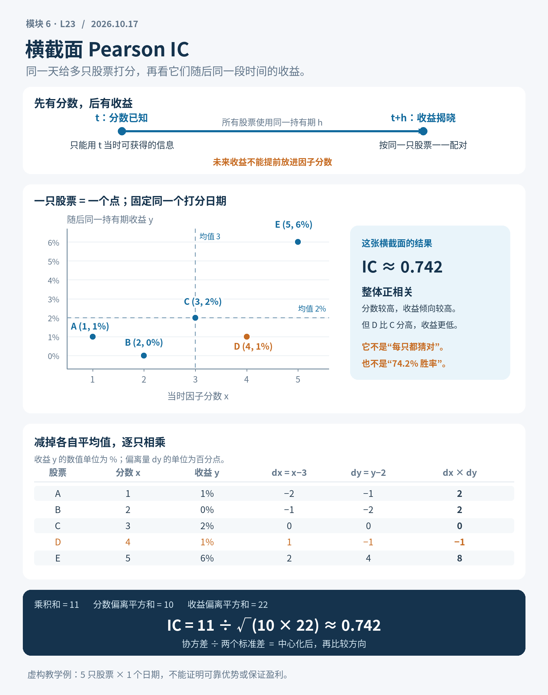

# IC：因子值与未来收益的截面关系

<blockquote class="callout callout-abstract">
核心命题
IC 衡量某个时点上因子值与未来收益的横截面相关。单个平均 IC 不足以评价因子；必须同时控制时间对齐、股票池、截面规模、依赖、暴露和交易可行性。

</blockquote>
<h2 id="section-1">一、本课目标</h2>
<ul>
<li>精确定义 Pearson IC；</li>
<li>正确构造逐日/逐月横截面 IC 序列；</li>
<li>对 Mean IC 使用 HAC 或 Block Bootstrap 推断；</li>
<li>分析覆盖率、截面样本数和极端值的影响；</li>
<li>区分 IC、回归斜率、分层收益与可交易 Alpha。</li>
</ul>
<h2 id="ic">二、IC 定义</h2>

在日期 $t$，对股票 $i=1,\ldots,N_t$：

$$
IC_t=Corr_i(F_{i,t},R_{i,t\to t+h})
$$

其中：

<ul>
<li>$F_{i,t}$：时点 $t$ 已知的因子；</li>
<li>$R_{i,t\to t+h}$：按实际交易时序定义的未来收益；</li>
<li>相关在当日股票横截面上计算；</li>
<li>$N_t$ 可随日期变化。</li>
</ul>

IC 是无量纲的线性关联强度。若因子方向定义为“越高越好”，正 IC 表示高因子股票未来收益倾向更高。

<section class="cor-daily" aria-labelledby="cross-sectional-pearson-ic">
<h2 id="cross-sectional-pearson-ic">横截面 Pearson IC：把同一天的分数，与随后收益逐只配对</h2>

2026-10-17 · 5–10 分钟：看图 2 分钟、跟算 3 分钟、思考 1–2 分钟

已经会“各自减均值 → 偏差相乘 → 用标准差归一化”，就可以看懂 Pearson IC。今天只取<strong>一个固定日期的多只股票</strong>：把当时真实可得的因子分数，与随后同一持有期的收益逐只配对，事后检验两列数的线性关系。

<h3 id="ic-daily-pairing">1. 先固定日期，再等未来发生</h3>

先约定日期 $t$ 的股票池、打分时点，以及从 $t$ 的约定交易起点到 $t+h$ 的统一持有期。对每只股票记下当时的因子分数 $x_i$；<strong>等持有期结束后</strong>，才能观察并填入它对应的未来收益 $y_i$。每一行都必须是同一只股票的“当时分数 + 随后收益”。

真实打分必须早于相应的交易机会。分数只能使用当时已经获得的信息，不能混入尚未披露的财报或未来价格；若收盘后才算出分数，就不能假设已经按当天收盘价买入。股票池、打分时点和持有期都应事先定好，再等待未来发生，不能看过结果再挑选。

<strong>横截面</strong>就是固定同一个日期，横着比较多只股票。它不是把一只股票多年的分数和收益拿来算时间序列相关；图上的<strong>一个点是一只股票，不是一天</strong>。

<figure class="cor-figure"><figcaption>图示展示：时序、同日逐只配对、减均值与归一化计算。收益整体下移的练习见下文。点击图片可放大；五只股票与全部数值均为自制教学示例。</figcaption></figure>

<h3 id="ic-daily-deviations">2. 先减均值：比较“比别人高多少”</h3>

假设分数越高，研究者事前越看好它。五只虚构股票 A–E 的分数是 <strong>1、2、3、4、5</strong>，随后统一持有期的收益是 <strong>1%、0%、2%、1%、6%</strong>。点群整体朝右上方，但并非每一步都单调：D 的分数 4 高于 C 的 3，收益 1% 却低于 C 的 2%。

分数均值 $\bar{x}=3$，收益均值 $\bar{y}=2\%$。分别减去各自的均值：分数偏差是 <strong>−2、−1、0、1、2</strong>；收益偏差是 <strong>−1、−2、0、−1、4 个百分点</strong>。例如 A 的收益偏差为 $1\%-2\%=-1$ 个百分点。

<table>
<caption>同一日期的五只股票：收益用百分数记录，收益偏差用百分点记录</caption>
<thead><tr><th scope="col">股票</th><th scope="col">当时分数 $x_i$</th><th scope="col">随后收益 $y_i$</th><th scope="col">$x_i-3$</th><th scope="col">$y_i-2\%$（百分点）</th><th scope="col">偏差乘积</th></tr></thead>
<tbody>
<tr><th scope="row">A</th><td>1</td><td>1%</td><td>−2</td><td>−1</td><td>2</td></tr>
<tr><th scope="row">B</th><td>2</td><td>0%</td><td>−1</td><td>−2</td><td>2</td></tr>
<tr><th scope="row">C</th><td>3</td><td>2%</td><td>0</td><td>0</td><td>0</td></tr>
<tr><th scope="row">D</th><td>4</td><td>1%</td><td>1</td><td>−1</td><td>−1</td></tr>
<tr><th scope="row">E</th><td>5</td><td>6%</td><td>2</td><td>4</td><td>8</td></tr>
<tr><th scope="row">合计</th><td>15</td><td>10%</td><td>0</td><td>0</td><td><strong>11</strong></td></tr>
</tbody></table>

<h3 id="ic-daily-products">3. 再相乘：方向一致加分，方向相反扣分</h3>

A、B 的分数和收益都低于各自均值，两个负偏差相乘为正；E 两项都高于均值，乘积也为正。D 的分数高于均值，收益却低于均值，乘积为 −1。C 两个偏差都是 0，没有贡献。

逐行相乘得到 <strong>2、2、0、−1、8</strong>，合计为 <strong>11</strong>。这不是在数“猜对了几只”：E 离两个均值较远，贡献 8，比 A 的 2 更大。Pearson 会保留偏离幅度，因此远处的点也可能明显影响结果。

<h3 id="ic-daily-normalize">4. 用标准差归一化，得到这一天的 IC</h3>

Pearson IC 就是这张横截面中，分数与随后收益的<strong>线性关系方向和强度</strong>。它等于协方差除以两列标准差的乘积：

$$IC_t=\frac{\operatorname{Cov}(x,y)}{s_xs_y}=\frac{\sum_i(x_i-\bar{x})(y_i-\bar{y})}{\sqrt{\sum_i(x_i-\bar{x})^2\;\sum_i(y_i-\bar{y})^2}}.$$

协方差和两个标准差采用相同分母约定时，无论都按 $n$ 还是都按 $n-1$ 计算，相关公式中的这部分都会抵消。所以上面可以直接用偏差乘积之和、偏差平方和来算。

分数偏差平方和为 $4+1+0+1+4=10$；收益偏差平方和为 $1+4+0+1+16=22$。因此：

<strong>$IC_t=11/\sqrt{10\times22}=11/\sqrt{220}\approx0.742$。</strong>

分母用各自的波动尺度归一化，消掉单位和尺度。把收益写成 1、0、2、1、6，或写成小数 0.01、0、0.02、0.01、0.06，结果都一样；后一种写法会让分子与分母同步缩小 100 倍。先理解“减均值”，以后也可把这个公式看成两个中心化向量夹角的余弦。

两列都必须有变化。若所有股票的分数相同，或所有未来收益相同，对应标准差就是 0，分母为 0，通常的 Pearson IC 无法定义。

<h3 id="ic-daily-interpret">5. 0.742 说明什么，哪些问题还没回答？</h3>

<strong>0.742 只说明这五只股票、这个日期、这个持有期存在正的线性关系：</strong>高分股票的随后收益相对倾向更高。它不是 74.2% 的胜率，不是 74.2% 的投资收益，也不保证下一次赚钱。计算中尚未给出仓位、成本或能否成交。

<blockquote class="callout callout-important">
相对更好，不等于绝对赚钱

正 IC 的截面里，股票仍可能亏损；整组收益变差，IC 仍可能为正。IC 比较分数和收益相对各自均值的关系，不能单独回答一项投资赚了多少钱。
</blockquote>

一次、五只虚构股票不足以证明可靠优势。真实研究需要在多个日期、未用于调参的数据上重复检验，检查异常值的影响，并纳入成本与交易可行性。今天计算的是<strong>原始数值的 Pearson IC</strong>；下一课再把数值换成名次，学习 Rank IC。

<h3 id="ic-daily-practice">6. 思考 1–2 分钟：全部收益都减 3 个百分点</h3>

分数保持 1、2、3、4、5 不变，把五个收益都减去 3 个百分点，变为 <strong>−2%、−3%、−1%、−2%、3%</strong>。新的收益均值是多少？各自减去新均值后，偏差变了吗？IC 会下降、归零，还是保持不变？先算 A 的一个偏差，再展开答案。

查看“全体收益下移”答案

<strong>IC 仍约为 0.742。</strong>原均值为 2%，全部减去 3 个百分点后，新均值为 −1%。以百分点为数值单位，五个新收益偏差逐行是：

<ul>
<li>A：$-2-(-1)=-1$；</li>
<li>B：$-3-(-1)=-2$；</li>
<li>C：$-1-(-1)=0$；</li>
<li>D：$-2-(-1)=-1$；</li>
<li>E：$3-(-1)=4$。</li>
</ul>

收益偏差仍为 −1、−2、0、−1、4，分数偏差也没变。偏差乘积和仍为 11，两个偏差平方和仍为 10 和 22，所以 $IC=11/\sqrt{220}\approx0.742$。

散点整体向下平移了 3 个百分点，点群的相对形状没变。现在四只股票亏损，整组平均收益为 −1%，IC 却仍为正。这正说明：<strong>IC 不回答绝对收益赚多少。</strong>

<strong>今天记住：</strong>横截面 IC 把同日多只股票的当时分数，与随后同一持有期收益逐一配对，事后检验相关。一次得到一个日期的 IC，接下来才能把多个日期的 IC 接成时间序列。

公式参考：<a href="https://www.itl.nist.gov/div898/software/dataplot/refman2/ch2/correlat.pdf" target="_blank" rel="noopener">NIST：Pearson 相关系数</a>。本页五只股票、图示与算例均为自制教学示例。

</section>

<h2 id="ic-2">三、先得到 IC 时间序列，再做长期推断</h2>

正确研究对象是：

$$
IC_1,IC_2,\ldots,IC_T
$$

然后估计：

$$
\overline{IC}=\frac{1}{T}\sum_{t=1}^{T}IC_t
$$

日期通常是长期独立信息的主要维度。不能把所有 <code>(date, asset)</code> 行合并后算一个巨大相关系数，并把股票行数当作独立样本量。

<h2 id="section-4">四、标签时序必须明确</h2>

假设因子使用当天收盘数据计算：

<ul>
<li>若收盘后才获得，不能按同一收盘价成交；</li>
<li>可定义下一开盘/下一收盘开始的收益；</li>
<li>停牌、涨跌限制、不可成交需进入标签和股票池；</li>
<li>财务因子按披露时间对齐；</li>
<li>未来 $h$ 日收益的终点与调仓机制一致。</li>
</ul>

一个 IC 数字的可信度，首先取决于标签而不是相关公式。

<h2 id="section-5">五、截面最小样本与覆盖率</h2>

相关系数在截面样本很小时不稳定。每个日期应记录：

<ul>
<li>有效股票数 $N_t$；</li>
<li>原始股票池数；</li>
<li>因子覆盖率；</li>
<li>标签覆盖率；</li>
<li>行业数量；</li>
<li>因子标准差；</li>
<li>是否大量并列值。</li>
</ul>

对于因子值或未来收益截面方差接近零的日期，相关系数没有稳定意义，应按事前规则标记缺失，而非强行填 0。

<h2 id="pearson-ic">六、Pearson IC 的特性</h2>

Pearson IC 对幅度信息敏感：极高因子值与极端收益会显著影响结果。适合：

<ul>
<li>预期关系近似线性；</li>
<li>因子尺度有经济意义；</li>
<li>极端值是真实且可交易的重要信息。</li>
</ul>

应同时检查：

<ul>
<li>散点图和分桶均值；</li>
<li>winsorization 前后；</li>
<li>影响点；</li>
<li>Rank IC；</li>
<li>行业/市值中性化前后。</li>
</ul>
<h2 id="python-ic">七、Python：稳健计算逐日 IC</h2>
<pre><code class="language-python">from __future__ import annotations

from dataclasses import dataclass
import numpy as np
import pandas as pd

@dataclass(frozen=True)
class DailyIC:
    date: pd.Timestamp
    ic: float
    nobs: int
    factor_std: float
    return_std: float

def compute_daily_ic(
    panel: pd.DataFrame,
    factor_col: str = "factor",
    return_col: str = "fwd_return",
    min_obs: int = 30,
) -&gt; pd.DataFrame:
    required = {"date", factor_col, return_col}
    missing = required - set(panel.columns)
    if missing:
        raise KeyError(f"缺少字段: {sorted(missing)}")

    rows: list[DailyIC] = []
    for date, day in panel.groupby("date", sort=True):
        x = day[[factor_col, return_col]].replace([np.inf, -np.inf], np.nan).dropna()
        n = len(x)
        f_std = float(x[factor_col].std(ddof=1)) if n &gt;= 2 else np.nan
        r_std = float(x[return_col].std(ddof=1)) if n &gt;= 2 else np.nan
        if n &lt; min_obs or not np.isfinite(f_std) or not np.isfinite(r_std) \
                or f_std &lt;= 0 or r_std &lt;= 0:
            ic = np.nan
        else:
            ic = float(x[factor_col].corr(x[return_col], method="pearson"))
        rows.append(DailyIC(pd.Timestamp(date), ic, n, f_std, r_std))

    return pd.DataFrame([r.__dict__ for r in rows]).set_index("date")
</code></pre>
<h2 id="mean-ic">八、Mean IC 的推断</h2>
<pre><code class="language-python">import statsmodels.api as sm

ic_series = daily_ic["ic"].dropna()
fit = sm.OLS(
    ic_series.to_numpy(),
    np.ones((len(ic_series), 1)),
).fit(cov_type="HAC", cov_kwds={"maxlags": 5})

summary = {
    "T": len(ic_series),
    "mean_ic": float(fit.params[0]),
    "hac_se": float(fit.bse[0]),
    "t_hac": float(fit.tvalues[0]),
    "p_hac": float(fit.pvalues[0]),
    "positive_ratio": float((ic_series &gt; 0).mean()),
    "lag1_acf": float(ic_series.autocorr(1)),
}
print(summary)
</code></pre>

<code>maxlags</code> 应根据频率、标签重叠和持有机制预先设置，并用 Block Bootstrap 复验。

<h2 id="section-9">九、等权日期与按截面精度加权</h2>

普通 Mean IC 对每个日期等权。有人会按 $N_t$ 或相关系数标准误加权，但这改变目标参数：

<ul>
<li>日期等权：一个时期一个投票；</li>
<li>股票数加权：大股票池日期权重更高；</li>
<li>精度加权：低估计方差日期权重更高。</li>
</ul>

若股票池数量随年代系统变化，按 $N_t$ 加权可能让后期主导。主结果建议日期等权，并将其他加权作为稳健性分析。

<h2 id="ic-3">十、IC 与回归斜率</h2>

一元截面回归：

$$
R_{i,t+1}=\alpha_t+\beta_tF_{i,t}+\varepsilon_{i,t+1}
$$

斜率与相关关系：

$$
\beta_t=IC_t\frac{\sigma_{R,t}}{\sigma_{F,t}}
$$

IC 无量纲，斜率保留因子与收益尺度。因子标准化后，斜率可解释为因子增加一个截面标准差对应的未来收益变化。

<h2 id="ic-4">十一、IC 与分层收益并不等价</h2>

高 IC 不保证：

<ul>
<li>分层收益严格单调；</li>
<li>顶底组价差足够大；</li>
<li>成本后盈利；</li>
<li>权重可构建；</li>
<li>容量可接受；</li>
<li>极端风险可控。</li>
</ul>

IC 也可能由中间部分线性关系贡献，而可交易的尾部分组不稳定。反之，非线性“只在极端组有效”的因子可能 IC 不高，但多空组合有价值。

<h2 id="ic-5">十二、中性化与条件 IC</h2>

常见比较：

<ol>
<li>原始因子 vs 原始未来收益；</li>
<li>中性因子 vs 原始未来收益；</li>
<li>原始因子 vs 行业/市值调整后的未来收益；</li>
<li>中性因子 vs 调整后未来收益。</li>
</ol>

四者回答不同问题。必须明确你的目标是预测总收益、特异收益还是风险调整收益。

<h2 id="ic-6">十三、IC 稳健性面板</h2>

至少输出：

<ul>
<li>全样本 Mean IC、HAC 区间；</li>
<li>Rank IC；</li>
<li>年度/季度 Mean IC；</li>
<li>滚动 12/24 月 Mean IC；</li>
<li>正 IC 比例；</li>
<li>不同市值/行业/状态；</li>
<li>去除极端日期；</li>
<li>原始与中性化；</li>
<li>多持有期 decay；</li>
<li>OOS IC。</li>
</ul>

稳健性分析必须区分事前主结果和事后探索结果，并进行多重校正。

<h2 id="section-14">十四、常见错误</h2>
<ul>
<li>对整个面板一次性计算相关。</li>
<li>因子收盘后生成，却使用当日收盘开始的标签。</li>
<li>小截面日期强行填 IC=0。</li>
<li>只报告 Mean IC，不报告时间序列不确定性。</li>
<li>因子方向看结果后翻转而不计试验。</li>
<li>把 IC 显著直接等同于可交易 alpha。</li>
<li>忽略股票池变化、覆盖率和退市样本。</li>
</ul>
<h2 id="section-15">十五、练习</h2>
<h3 id="1">练习 1</h3>

某日因子标准差 2，未来收益标准差 4%，IC=0.05。求一元截面回归斜率，并解释单位。

<h3 id="2">练习 2</h3>

为什么把所有日截面股票合并计算一个相关，会混合截面和时间关系？

<h3 id="3">练习 3</h3>

设计一个 leave-one-year-out IC 稳健性分析，并定义何时判定结果由单一年份主导。

参考答案

<ol>
<li>$\beta=0.05\times0.04/2=0.001$，因子原始值增加 1 单位，未来收益条件均值增加约 0.1%。</li>
<li>合并相关受到日期均值、截面尺度和股票构成变化影响，并把同日共同冲击当作独立行，不能代表“典型日期上的截面预测”。</li>
<li>每次删除一年重算 Mean IC/HAC 区间；若删除任一年导致符号反转、区间状态改变或估计下降超过预设比例，可标记集中风险。</li>
</ol>

<h2 id="section-19">十六、验收标准</h2>
<ul>
<li class="task-item"> 能精确定义逐日 IC。</li>
<li class="task-item"> 能构造正确时序的未来收益标签。</li>
<li class="task-item"> 能输出 IC 序列及 HAC 推断。</li>
<li class="task-item"> 能解释 IC 与回归斜率的关系。</li>
<li class="task-item"> 能列出 IC 不等于可交易性的原因。</li>
</ul>

上一课：<a href="#/lesson/l22">L22-数据窥探、选择偏差与研究治理</a>　下一课：<a href="#/lesson/l24">L24-RankIC：排序信息与稳健性</a>

